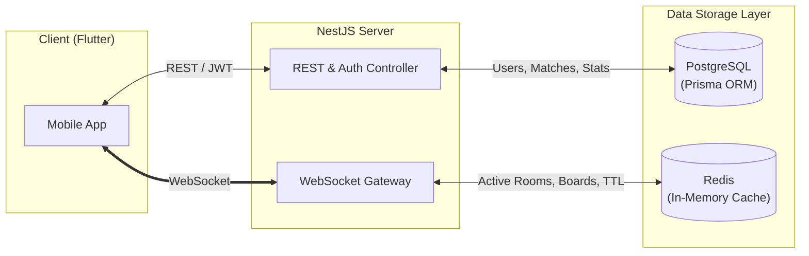

# ĐẶC TẢ TỔNG QUAN DỰ ÁN BUNNY COVE (PROJECT SPECIFICATION)

> **Tên dự án**: Bunny Cove 🐰  
> **Nền tảng mục tiêu**: Mobile (ưu tiên tối ưu cho người dùng iOS) & Backend  
> **Công nghệ chủ đạo**: Flutter (Mobile) + NestJS (Backend Server)  
> **Mục tiêu cốt lõi**: Nền tảng vũ trụ game ấm cúng (Cozy Social Gaming Universe) kết nối bạn bè, cặp đôi và cộng đồng thông qua hệ sinh thái phòng game đa dạng, kho mini-game cắm-rút phong phú (board games, party games, đối kháng trí tuệ) và hệ thống trò chuyện thời gian thực sinh động.

---

## 1. TỔNG QUAN VÀ ĐỊNH HƯỚNG DỰ ÁN

### 1.1. Tầm nhìn & Phong cách Trải nghiệm (Concept & Aesthetics)
- **Concept "Cozy Social Gaming Universe"**: Ứng dụng tạo ra một không gian ấm cúng, vui tươi, thư giãn và gắn kết cộng đồng người chơi thông qua các mini-game đa dạng và phòng chơi linh hoạt.
- **Phong cách thẩm mỹ (Aesthetics)**:
  - Tông màu chủ đạo: Hệ thống "Honey Oak & Sweet Cream" đồng bộ 1:1 giữa Mobile và Web, hỗ trợ trọn vẹn cả 2 Theme (Light Mode: Kem Sữa #FAF7F2 & Gỗ Sồi #C68B59; Dark Mode: Gỗ Mun #1F1A17 & Hổ Phách #D99B66), kết hợp các điểm nhấn Mascot (Cà rốt cam #FFA502, Nơ hồng #FF7597, Cỏ ba lá xanh #4E8752).
  - Hình tượng linh vật: Chú thỏ trắng dễ thương (Bunny mascot) xuyên suốt từ logo, sticker chat, tem cờ caro đến dấu dập bingo.
  - Vi tương tác (Micro-interactions) & Phản hồi xúc giác (Haptic Feedback): Rung phản hồi nhẹ chuẩn iOS (`HapticFeedback.selectionClick()` khi bấm nút, đi quân cờ; `HapticFeedback.heavyImpact()` khi chiến thắng).
  - Trải nghiệm thị giác: Hiệu ứng chuyển cảnh trượt (`_buildSlideRoute`), hiệu ứng khung xương tải dữ liệu (Shimmer Skeleton), bo góc mềm mại trên toàn bộ UI.

### 1.2. Đối tượng Người dùng & Nền tảng
- **Mục tiêu chính**: Người dùng hệ điều hành iOS (iPhone).
- **Khả năng mở rộng**: Nhờ sử dụng Flutter, ứng dụng có thể biên dịch và triển khai linh hoạt lên cả Android trong tương lai mà không phải viết lại logic.

---

## 2. KIẾN TRÚC HỆ THỐNG VÀ CÔNG NGHỆ

### 2.1. Phân chia Cấu trúc Thư mục
```text
Bunny Cove/
├── mobile/       # Ứng dụng di động Flutter (iOS & Android)
├── server/       # Backend API & Real-time WebSocket Server (NestJS)
├── AGENTS.md     # Bộ quy tắc kỹ thuật và điều lệ phát triển (Single Source of Truth)
└── general.md    # Tài liệu đặc tả tổng quan dự án
```

### 2.2. Công nghệ Phía Mobile (`mobile/`)
- **Framework**: Flutter (Dart SDK >= 3.0.0).
- **Kiến trúc**: Feature-Based Clean Architecture (`lib/features/[feature_name]/...`).
- **Quản lý Trạng thái (State Management)**: BLoC / Cubit (phân tách rõ `cubit.dart` và `state.dart`), đảm bảo kiểm tra `isClosed` an toàn trong các luồng bất đồng bộ.
- **Dependency Injection**: Service Locator (`get_it` - `sl`).
- **Giao thức Mạng**:
  - REST Client: `DioClient` bọc trong Service Locator, bắt lỗi qua `try-catch DioException`, trả về `Future<Either<ErrorResponse, T>>`.
  - Real-time Client: `socket_io_client` qua kết nối WebSocket bảo mật (WSS).
- **Hệ thống Routing**: Quản lý tập trung qua `AppRouter`, bắt buộc sử dụng hiệu ứng trượt màn hình `_buildSlideRoute` và điều hướng qua `NavigationUtils` (tự động hạ bàn phím).
- **Quy chuẩn Giao diện**: Sử dụng thư viện `flutter_screenutil` (`.w`, `.h`, `.sp`) đảm bảo giao diện thích ứng responsive trên mọi kích thước màn hình iPhone; tự động ẩn bàn phím (`GestureDetector` + `FocusScope.unfocus()`); bọc các trang bằng `SingleChildScrollView` chống tràn pixel.

### 2.3. Công nghệ Phía Server (`server/`)
- **Framework**: NestJS (TypeScript, Node.js v18+).
- **Kiến trúc**: 3-Layer Clean Architecture:
  - *Controller / Gateway Layer*: Tiếp nhận HTTP Request và WebSocket Events, xác thực dữ liệu qua DTO / `class-validator`, phản hồi JSON chuẩn hóa.
  - *UseCase / Service Layer*: Đảm nhiệm toàn bộ quy tắc nghiệp vụ (Business Rules), tính toán luật chơi (Game Engines), độc lập hoàn toàn với tầng giao vận.
  - *Repository Layer*: Tương tác dữ liệu (Prisma ORM với PostgreSQL, Redis Store).
- **Cơ sở dữ liệu (Database)**:
  - *Dữ liệu bền vững (Persistent)*: **PostgreSQL** kết hợp **Prisma ORM** (quản lý User, Lịch sử trận đấu, Thống kê, Cặp đôi).
  - *Dữ liệu tức thời & Bộ nhớ đệm (Realtime Cache)*: **Redis** (quản lý trạng thái phòng chơi hoạt động, ván cờ, countdown 30s, socket adapter).
- **Kết nối Thời gian thực**: `@nestjs/websockets` và `@nestjs/platform-socket.io`.
- **Bảo mật & Xác thực**: JSON Web Tokens (JWT), Access Token ngắn hạn và Refresh Token trong HTTP-only Cookie, cấu hình Rate Limiting và CORS chặt chẽ.
- **Chuẩn hóa Phản hồi & Ghi log**:
  - Format thành công: `{ "success": true, "code": "SUCCESS_CODE", "data": ... }`
  - Format thất bại: `{ "success": false, "error": { "code": "ERROR_CODE", "message": "...", "details": ... } }`
  - Mã phản hồi dạng chuỗi (String response codes) đồng bộ tập trung để hỗ trợ đa ngôn ngữ i18n trên ứng dụng.
  - Ghi log có cấu trúc dạng JSON (Structured Logging với Winston/Pino).

### 2.4. Công nghệ Phía Web (`web/`)
- **Framework**: Next.js 14+ / React với App Router.
- **Kiến trúc**: 3-Layer Clean Architecture:
  - *Domain Layer (`src/domain/`)*: `entities/` (Types/Entities thuần), `repositories/` (Interfaces), `usecases/` (Quy tắc nghiệp vụ độc lập UI & Mạng).
  - *Application Layer (`src/application/`)*: `dto/`, `mappers/`, `services/`.
  - *Infrastructure Layer (`src/infrastructure/`)*: `repositories/` (Hiện thực hóa domain repository), `rtk/` (hoặc zustand cấu hình global state & base API), `http/` (Axios/Fetch client), `api/` (Endpoints).
  - *Presentation Layer (`src/presentation/`)*: `pages/` (Client components), `components/` (UI tái sử dụng), `hooks/` (Custom hooks UI), `providers/` (`ThemeProvider`, `ReduxProvider`...).
  - *Thin Entrypoint App Router (`src/app/`)*: Các file `page.tsx` cực mỏng, chỉ nhận params/searchParams phía server rồi truyền trực tiếp xuống component tương ứng của tầng Presentation.
- **Quản lý Trạng thái & API**:
  - Global State: Redux Toolkit hoặc Zustand làm Single Source of Truth.
  - Data Fetching & Caching: RTK Query hoặc React Query.
  - Decoupling qua Repository Pattern.
- **Giao diện & Chủ đề (Theme)**:
  - Tích hợp sẵn Light/Dark Theme tập trung qua `ThemeProvider` và nút `ThemeToggle`.
  - Tailwind CSS với bộ Design Tokens "Honey Oak & Sweet Cream" CSS variables (`var(--primary)`, `var(--background)`, `var(--foreground)`, `var(--border)`, `var(--success)`) và font chữ Merriweather (`var(--font-merriweather)`).
  - Chuẩn hóa container (`container mx-auto px-4` hoặc `px-6`), shadow tokens, tương tác `cursor-pointer` và `select-none`.
  - Tối ưu Responsive 100% trên cả 3 giao diện Mobile, Tablet và Desktop.
- **Bản địa hóa & Form**: Đa ngôn ngữ (i18n) với locales dictionaries, Form validation qua React Hook Form + Zod.

### 2.5. Kiến trúc Mini-Game Cắm Rút (Pluggable Game Engine - Strategy Pattern)
Để đảm bảo khả năng mở rộng thêm nhiều trò chơi mới trong tương lai (không bị giới hạn hay hardcode chỉ có Caro và Bingo), hệ thống áp dụng mẫu thiết kế **Plugin / Strategy Pattern**:
- **Interface trừu tượng `IGameEngine`**: Định nghĩa hợp đồng chung cho mọi trò chơi:
  - `initGame(players, config)`: Khởi tạo bàn cờ / trạng thái ván đấu ban đầu.
  - `handleAction(state, player, actionType, payload)`: Xử lý nước đi, kiểm tra hợp lệ, xác định người thắng.
  - `serializeState(state, forPlayerId)`: Đóng gói trạng thái (hỗ trợ che giấu thông tin / sương mù nếu game yêu cầu).
- **Trình quản lý tập trung `GameRegistryService`**: Tự động đăng ký các engine game. Phía Client có thể gọi `game:list` để lấy danh sách game đang hỗ trợ.
- **WebSocket Gateway dùng chung**: `RoomGateway` chỉ tiếp nhận 3 sự kiện bao quát:
  - `game:list`: Lấy danh sách trò chơi có sẵn.
  - `game:start`: Khởi động trò chơi bất kỳ theo mã định danh `gameType`.
  - `game:action`: Tiếp nhận mọi hành vi của người chơi (`move`, `call_number`, `draw`, v.v.) và chuyển giao cho Engine tương ứng.
  - *Lợi ích*: Khi bổ sung game thứ 3, thứ 4 (Battleship, Connect4, Cờ Vua, v.v.), lập trình viên chỉ cần tạo thêm 1 file Engine mới và đăng ký mà **không cần chỉnh sửa một dòng code nào trong Room Module hay Socket Gateway**.

---

## 3. ĐẶC TẢ CHI TIẾT CÁC TÍNH NĂNG CHÍNH

### 3.1. Hệ thống Phòng Chơi Thời Gian Thực (Real-Time Multiplayer Room System)
- **Quy tắc phòng linh hoạt**: Hỗ trợ đa dạng số lượng người chơi tùy theo chế độ và mini-game (1v1 đối kháng, party 4 người, hoặc phòng nhóm cộng đồng).
- **Tạo phòng (Create Room)**:
  - Người chơi chọn "Tạo phòng" -> Server sinh một mã phòng duy nhất gồm 6 ký tự dễ nhớ (ví dụ: `BUNNY-92` hoặc `HOPE-78`).
  - Người tạo phòng trở thành Chủ phòng (Host), hiển thị màn hình phòng chờ kèm mã phòng và mã QR để mời bạn bè.
- **Vào phòng (Join Room)**:
  - Người chơi nhập mã phòng hoặc quét QR Code / mở Universal Link trên iOS.
  - Server kiểm tra: Nếu mã hợp lệ và phòng còn chỗ -> Cho phép tham gia và phát socket thông báo tới các thành viên trong phòng. Nếu phòng đầy hoặc sai mã -> Trả về lỗi chuẩn (`room_full`, `room_not_found`).
- **Trạng thái Sẵn sàng (Ready State)**:
  - Các người chơi trong phòng bật trạng thái "Sẵn sàng (Ready)".
  - Khi phòng đạt điều kiện sẵn sàng, màn hình mở khóa danh sách kho trò chơi mini phong phú để Chủ phòng hoặc các thành viên cùng bắt đầu ván đấu.
- **Quản lý Kết nối & Mất mạng (Disconnection & Reconnection)**:
  - Hỗ trợ cơ chế Heartbeat (Ping/Pong) mỗi 5 giây.
  - Nếu một người chơi bị ngắt kết nối tạm thời (chuyển app xuống nền, mất sóng wifi), hệ thống kích hoạt thời gian chờ khoan hồng 30 giây (30-second Grace Period).
  - Nếu kết nối lại trong 30s: Khôi phục tức thì toàn bộ trạng thái phòng và bàn chơi hiện tại.
  - Nếu quá 30s: Xử lý kết quả ván đấu hoặc cho phép tiếp tục phòng an toàn.

---

### 3.2. Trò chơi 1: Cờ Caro (Gomoku)
- **Kích thước bàn cờ**: 15x15 ô chuẩn Gomoku.
- **Biểu tượng quân cờ**:
  - Người chơi 1: Cà rốt cam (Carrot 🥕).
  - Người chơi 2: Cỏ ba lá may mắn / Nơ hồng (Bow 🎀).
- **Cơ chế chơi**:
  - Lượt đi luân phiên (Turn-based).
  - Giới hạn thời gian mỗi lượt: 30 giây. Có thanh đếm ngược tiến trình. Quá giờ sẽ tự động chuyển lượt hoặc xử thua sau 2 lượt liên tiếp không đi.
- **Kiểm soát tính hợp lệ phía Server (Server-Authoritative Validation)**:
  - Toàn bộ trạng thái bàn cờ 15x15 lưu trữ trên Server.
  - Client chỉ gửi tọa độ `(x, y)`.
  - Server kiểm tra: đúng lượt người gửi không, ô cờ đã có quân chưa, ván đấu còn diễn ra không.
  - Thuật toán kiểm tra thắng thua: Duyệt 5 quân cờ liên tiếp trên 4 hướng:
    1. Hàng ngang.
    2. Hàng dọc.
    3. Đường chéo chính (Top-Left đến Bottom-Right).
    4. Đường chéo phụ (Top-Right đến Bottom-Left).
  - Tùy chọn luật thi đấu: Hỗ trợ tùy chọn bật/tắt "Chặn 2 đầu" trong cài đặt phòng.
- **Tính năng tương tác nâng cao**:
  - Gợi ý nước đi vừa đánh gần nhất (highlight hiệu ứng viền phát sáng nhẹ).
  - Nút xin đi lại (Undo Request): Cần đối phương đồng ý.
  - Nút xin hòa (Draw Request) và Đầu hàng (Surrender).
  - Hỗ trợ thu phóng và di chuyển bàn cờ mượt mà (Pinch-to-zoom & Pan) trên màn hình cảm ứng iPhone.

---

### 3.3. Trò chơi 2: Bingo 5x5 (Cozy Bingo)
- **Cấu trúc trò chơi**:
  - Bàn cờ dạng lưới 5x5 gồm 25 ô tương ứng với 25 số (từ 1 đến 25).
- **Giai đoạn Chuẩn bị (Setup Phase)**:
  - Mỗi người chơi nhận một bảng 5x5 trống.
  - Người chơi có thể tự tay xếp các số từ 1 đến 25 vào các vị trí mong muốn, hoặc bấm nút "Xáo bài tự động (Auto-Shuffle)" để hoàn thành nhanh.
  - Khi cả hai gửi ma trận bàn cờ lên Server -> Trận đấu chính thức bắt đầu.
- **Giai đoạn Thi đấu (Playing Phase)**:
  - Hai người luân phiên gọi số trong lượt của mình.
  - Khi Người chơi A chọn số `17`:
    - Server ghi nhận số `17` đã được gọi.
    - Phát socket tới cả hai máy.
    - Cả bảng của A và B đều tự động đóng dấu linh vật thỏ (Bunny Stamp) vào ô số `17`.
- **Cơ chế Tính điểm & Chiến thắng**:
  - Mỗi khi hoàn thành đủ 5 ô trên một đường thẳng (hàng ngang, cột dọc hoặc đường chéo), người chơi mở khóa được 1 chữ cái trong chuỗi **B - I - N - G - O**.
  - Server liên tục tính toán số đường hoàn thành của cả hai phía.
  - Người đầu tiên đạt đủ 5 đường hoàn thành (đủ 5 chữ cái BINGO) và bấm nút **BINGO!** sẽ giành chiến thắng chung cuộc kèm hiệu ứng pháo hoa pastel rực rỡ.

---

### 3.4. Hệ thống Chat Thời Gian Thực (In-Room Real-time Chat)
- **Hình thức hiển thị**:
  - Màn hình chat đầy đủ trong phòng chờ.
  - Khung chat thu nhỏ / thanh trượt nổi (Floating / Sliding Bottom Sheet) ngay trong màn hình chơi game, giúp 2 người vừa giao lưu vừa không bị gián đoạn ván đấu.
- **Các hình thức tương tác**:
  - **Tin nhắn văn bản (Instant Text Messaging)**: Gửi và nhận tức thì qua WebSocket, hiển thị trạng thái đã gửi/đã nhận.
  - **Bộ sưu tập Sticker Thỏ Độc Quyền (Bunny Stickers Pack)**:
    - Vui vẻ / Cười tít mắt.
    - Giận dỗi / Phồng má.
    - Cổ vũ / Bắn tim.
    - Bất ngờ / Thè lưỡi trêu chọc.
    - Khóc nhè khi thua cuộc.
  - **Phản hồi nhanh (Quick Canned Reactions)**: Các câu thoại ngắn định sẵn bấm gửi ngay ("Đến lượt bạn nè!", "Nước cờ hay đó!", "Chờ mình xíu nhé 🐰", "Chuẩn bị thua đi nha!").
  - **Tin nhắn hệ thống (System Notification Logs)**: Thông báo trạng thái ("Thỏ Trắng vừa tham gia phòng", "Thỏ Hồng đã sẵn sàng", "Ván cờ mới đã bắt đầu").

---

## 4. BẢNG ĐẶC TẢ GIAO THỨC WEBSOCKET (SOCKET.IO EVENTS)

Mọi trao đổi dữ liệu thời gian thực giữa `mobile` và `server` được chuẩn hóa theo danh mục sự kiện sau:

| Tên Sự kiện (Event Name) | Nguồn gửi | Dữ liệu kèm theo (Payload) | Mục đích / Xử lý |
| :--- | :--- | :--- | :--- |
| `room:create` | Client -> Server | `{ playerName, avatarId }` | Yêu cầu tạo phòng mới, Server cấp `roomId` 6 ký tự |
| `room:join` | Client -> Server | `{ roomId, playerName, avatarId }` | Yêu cầu vào phòng với mã |
| `room:player_joined` | Server -> Client | `{ players: [Player, Player] }` | Báo cho các máy trong phòng khi có người tham gia |
| `room:ready` | Client -> Server | `{ isReady: boolean }` | Bật/tắt trạng thái sẵn sàng |
| `game:select` | Client -> Server | `{ gameType: 'CARO' \| 'BINGO' }` | Chọn trò chơi tiếp theo |
| `caro:move` | Client -> Server | `{ x: number, y: number }` | Gửi tọa độ nước cờ Caro |
| `caro:state_update` | Server -> Client | `{ board, nextTurn, winner, winningCells }` | Server đồng bộ lại bàn cờ và kết quả sau mỗi nước |
| `bingo:setup_board` | Client -> Server | `{ matrix: number[][] }` | Gửi bảng số 5x5 của người chơi khi bắt đầu |
| `bingo:call_number` | Client -> Server | `{ number: number }` | Gọi 1 số trong lượt Bingo |
| `bingo:state_update` | Server -> Client | `{ calledNumbers, playerLines, winner }` | Đồng bộ các số đã gạch và số dòng hoàn thành |
| `chat:send_message` | Client -> Server | `{ text, stickerId }` | Gửi tin nhắn hoặc sticker |
| `chat:new_message` | Server -> Client | `{ senderId, text, stickerId, timestamp }` | Phát tán tin nhắn tới đối phương |
| `room:player_disconnected` | Server -> Client | `{ playerId, gracePeriodSeconds }` | Báo đối phương tạm mất mạng, đếm ngược 30s |
| `room:player_reconnected` | Server -> Client | `{ playerId, gameState }` | Báo đối phương đã kết nối lại thành công |

---

## 5. THIẾT KẾ CƠ SỞ DỮ LIỆU (DATABASE ARCHITECTURE)

Hệ thống kết hợp giữa **PostgreSQL** (lưu trữ bền vững) và **Redis** (quản lý trạng thái tức thời):



### 5.1. Dữ liệu Bền vững: PostgreSQL (quản lý qua Prisma ORM)
- **Bảng `User`**:
  - `id` (UUID), `username`, `displayName`, `email` / `appleId`, `avatarUrl`, `passwordHash` (nếu dùng local auth), `createdAt`, `updatedAt`.
- **Bảng `Friendship` / `CouplePair`**:
  - `id`, `user1Id`, `user2Id`, `status` (`PENDING`, `ACCEPTED`), `anniversaryDate`, `createdAt`.
- **Bảng `MatchHistory`**:
  - `id`, `gameType` (`CARO` / `BINGO`), `roomCode`, `player1Id`, `player2Id`, `winnerId`, `durationSeconds`, `moveHistory` (JSONB - lưu toàn bộ nước cờ / số gọi để xem lại), `createdAt`.
- **Bảng `UserStats`**:
  - `userId`, `gameType`, `totalMatches`, `wins`, `losses`, `draws`, `winStreak`, `updatedAt`.

### 5.2. Dữ liệu Tức thời & Bộ nhớ đệm: Redis (Real-time Session Cache)
- **Cấu trúc lưu trữ phòng (`room:{roomId}`)**:
  - Kiểu dữ liệu: Redis Hash hoặc JSON.
  - Các trường: `roomId`, `hostId`, `guestId`, `gameType`, `status` (`WAITING`, `READY`, `PLAYING`, `PAUSED`), `turnPlayerId`, `turnDeadline`.
  - Cơ chế tự hủy (**TTL - Time To Live**): Đặt thời gian sống 60 phút. Nếu 2 người tắt app mà không đóng phòng, Redis tự động giải phóng bộ nhớ.
- **Trạng thái ván đấu đang diễn ra (`game:{roomId}:state`)**:
  - **Cờ Caro**: Mảng ma trận 15x15 chứa các giá trị `0` (trống), `1` (Người 1), `2` (Người 2), kèm tọa độ nước đi gần nhất.
  - **Bingo 5x5**: Ma trận 5x5 của từng người chơi, danh sách các số đã được gọi (`calledNumbers`), và danh sách các dòng đã hoàn thành của từng bên.
- **Quản lý rớt mạng tạm thời (Grace Period 30s)**:
  - Khóa `player:{playerId}:disconnect_timer` với TTL 30 giây. Nếu người chơi kết nối lại trước khi key hết hạn, phiên ván đấu được phục hồi nguyên vẹn.
- **Khả năng mở rộng (Socket.IO Redis Adapter)**:
  - Tích hợp `@socket.io/redis-adapter` khi cần mở rộng chạy nhiều máy chủ NestJS song song (Multi-instance / Horizontal Scaling).

### 5.3. Chiến lược Triển khai theo 2 Giai đoạn
1. **Giai đoạn 1 (Khởi tạo & MVP)**:
   - Dùng **PostgreSQL** cho User và MatchHistory.
   - Trạng thái phòng và ván đấu realtime có thể lưu trữ trực tiếp trong bộ nhớ RAM của NestJS Server (`Map<string, RoomState>`) để tinh giản hạ tầng.
2. **Giai đoạn 2 (Production)**:
   - Kết nối cụm **Redis** độc lập, chuyển toàn bộ state phòng sang Redis để đảm bảo khi Server reload/deploy không làm gián đoạn các ván đấu đang diễn ra.

---

## 6. TIÊU CHUẨN KỸ THUẬT VÀ QUY TẮC PHÁT TRIỂN (TUÂN THỦ `AGENTS.md`)

Mọi giai đoạn lập trình và mở rộng dự án Bunny Cove bắt buộc phải tuân thủ nghiêm ngặt các nguyên tắc được định nghĩa trong [AGENTS.md](file:///c:/Bone/Private/Bunny%20Cove/AGENTS.md):

1. **Giao tiếp và Trao đổi**:
   - Tất cả giải thích, lập kế hoạch, thảo luận và hướng dẫn cho người dùng viết bằng **Tiếng Việt** chuẩn xác.
   - Toàn bộ mã nguồn, tên hàm, tên biến, tài liệu API, chú thích code và Git commit message phải hoàn toàn bằng **Tiếng Anh**.
2. **Quy trình Thực thi (Workflow)**:
   - Trước khi thực hiện bất kỳ tác vụ phức tạp nào (từ 3 bước trở lên), phải lập kế hoạch hành động và lưu vết tại `tasks/todo.md`.
   - Cập nhật bài học kinh nghiệm tại `tasks/lessons.md` sau mỗi lần phản hồi hoặc sửa đổi.
3. **Tiêu chuẩn Mobile (Flutter)**:
   - Điều hướng sử dụng `NavigationUtils` và hiệu ứng trượt `_buildSlideRoute`.
   - Tránh hiện tượng nháy bàn phím khi pop màn hình bằng cách hạ Focus (`primaryFocus?.unfocus()`).
   - Sử dụng `.w`, `.h`, `.sp` từ `flutter_screenutil` cho toàn bộ kích thước giao diện.
   - Quản lý trạng thái bằng Cubit, phân tách `cubit.dart` và `state.dart`, kiểm tra `if (isClosed) return;`.
   - Thông báo luôn dùng `CustomSnackBar` và `CustomDialog`.
4. **Tiêu chuẩn Server (NestJS)**:
   - 3-Layer Clean Architecture (Controller/Gateway -> Service/UseCase -> Repository).
   - Chuẩn hóa mã phản hồi (Response Codes) tập trung, đồng bộ để ứng dụng mobile có thể dịch đa ngôn ngữ.
   - Bảo vệ hệ thống với JWT, Rate Limiting, CORS, mã hóa mật khẩu và logging có cấu trúc.
